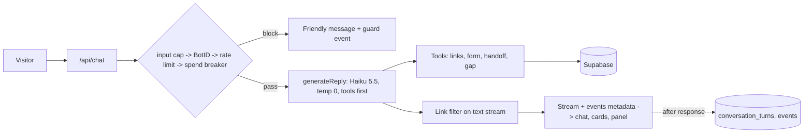

# Cadre AI support assistant

A support chat for visitors to [cadre.ai](https://cadre.ai): prospects, existing clients and anyone curious.
It answers only from a knowledge base built from cadre.ai pages, where every file names its source page and has an evidence file.
Pricing, account issues, security specifics and anything the knowledge base doesn't cover go to a human, along with the context of the conversation.
The model never writes URLs. Links reach the visitor only as cards rendered from tool results, and only for allowlisted hosts.

Live: <https://cadre.mejohnc.org> (also <https://agent-evaluation-five.vercel.app>)

Built by John Christensen with Claude Code. Brief: `docs/client-brief.md`. Plan and gates: `plan.md`. Decisions: `docs/decisions.md` (D1 to D20).

## What to look at first

- **The Behind the scenes panel in the live UI** (header button). For each reply it shows the guards that ran, the tools called, saved handoffs and gaps, model, tokens, estimated cost and latency, plus a Sources tab listing every knowledge file's source page and verified date (D17).
- **`evals/scenarios.yaml` and `evals/rubric.md`**: 39 scenarios in three tiers, with global checks applied to every reply. The rubric is calibrated against `evals/calibration.yaml` (D6).
- **`docs/decisions.md`**: 20 decisions, each with the rejected alternative and the evidence. D5 (model choice), D9 to D11 (conflicting facts on Cadre's own site), D17 (in-app observability) and D20 (tools before text) are the most useful.
- **`src/lib/guards/`**: one file per guard, each with tests written from the failure modes in `docs/guards.md` before the guard existed (G5).
- **`src/lib/prompt/system.md`**: the bot's rules, 43 lines. `prompt.snapshot.md` next to it is the reviewed copy that G4 checks against.
- **`knowledge/` with `knowledge/_evidence/`**: 21 topic files plus `links.md` (22 allowlisted links). Frontmatter carries `source:` and `verified:`, and G3 enforces it.

## How it works

`POST /api/chat` (`src/app/api/chat/route.ts`) runs the guards in order: input cap, BotID, rate limit, spend breaker. A guard that trips returns a friendly assistant message, never a blank chat or a 500.
The route then calls `generateReply` (`src/lib/reply.ts`), the only reply path, shared with the eval runner. It streams from Haiku 5.5 at temperature 0 with five tools; the first step must be a tool decision (`answer_directly` when none is needed, D20), and the link filter and price guard run on the text stream.
A step that has already written text ends the turn, so the visitor gets one reply (the `single_reply` fix, commit 7596fdb).
When the reply finishes, the turn's typed events are attached to the stream as message metadata, and the panel renders them.
After the response is sent, `after()` writes the turn to `conversation_turns` (emails redacted, OpenRouter's billed cost) and flushes the events to `events`.



| Tool | Does | Renders |
| --- | --- | --- |
| `get_booking_link` | Returns the allowlisted strategy-call or AI Maturity Index link | `NextStepCard` with one button |
| `get_page_link` | Returns a `links.md` page plus a one-line description from its knowledge file (D18) | `PageCard`, the whole card is one link |
| `show_contact_form` | Asks for details through a typed form; writes nothing (D14) | `ContactFormCard`; submitting it sends the details as the visitor's own message |
| `request_human_followup` | Checks contact provenance, writes the `handoffs` row | `HandoffCard`, which confirms only when the row was written (`ok: true`) |
| `log_knowledge_gap` | Records an unanswered question in `knowledge_gaps` | Nothing |

Every card validates its tool output with zod before rendering (`src/app/components/tool-outputs.ts`). Anything unexpected renders nothing.

## Correctness evidence

### Gates

Each gate is a mechanical check that was made to fail once to prove it works (`plan.md`, Gates).

| Gate | Checks | Where it runs |
| --- | --- | --- |
| G1 | No secrets staged (`gitleaks protect --staged`) | husky pre-commit |
| G2 | Claude cannot read or edit `.env*` files | Claude Code PreToolUse hook, `scripts/hooks/block-env-edits.mjs` |
| G3 | Knowledge frontmatter, allowed source hosts, https links on allowed hosts | `npm run check:kb`, pre-commit and CI |
| G4 | Prompt under 30k estimated tokens and equal to the reviewed snapshot | `npm run check:prompt`, CI |
| G5 | Guard unit tests from `docs/guards.md` failure modes | Vitest, CI |
| G6 | Tier 1 deterministic evals; a failure blocks merge | `npm run eval -- --tier 1 --ci`, CI |
| G7 | No scenario or assertion removed without an `Eval-change:` trailer | `scripts/check-eval-integrity.ts`, CI on PRs |
| G8 | Production smoke test once production serves the pushed commit (D8), and every 30 minutes | `.github/workflows/smoke.yml`, Playwright |
| G9 | Edited files lint clean; typecheck passes before Claude stops | Claude Code PostToolUse and Stop hooks |
| G10 | Submission zip: git history intact, gitleaks clean, small, CLAUDE.md and plan.md at root | Manual, at wrap (not yet run) |

`npm run gate` runs everything CI runs: typecheck, lint, unit tests, G3, G4, G7 and Tier 1.

### Eval suite

`evals/run.ts` calls the same `generateReply` as production, with an in-memory store.

| Tier | Scenarios | How it's scored | What it covers |
| --- | --- | --- | --- |
| 1 | 26 | Regex `expect`/`reject`, tool calls and tool arguments | The brief's scenarios and common inquiries, the knowledge traps (D9 to D11), partners (D19), handoffs, contact form, page cards |
| 2 | 6 | Sonnet 5.5 judge on `evals/rubric.md`: grounded, answers_question, correct_escalation, tone, concise | Answers regexes can't check: formats, industry fit, vague prospects, pricing pushback |
| 3 | 7 | Deterministic | Adversarial: prompt leak, "pretend you're human", pasted instructions, a sensitive number, URL bait, price coaxing, off-topic |

Every scenario also runs six global checks (`evals/assertions.ts`): `single_reply`, `handoff_claim_after_result`, `phantom_card`, `no_url`, `no_currency` and `numbers_grounded`.

### Judge calibration (D6)

The judge agreed with the reference labels on 10 of 10 transcripts after two rubric changes.
`correct_escalation` stopped double-counting invented facts (that is `grounded`'s job), and about 120 words became a target rather than a limit for `concise`.
The first run was 9/10.
**Limitation:** the labels are not an independent human review. Six are real Haiku replies labelled by Claude's claim-by-claim check, four are synthetic failures labelled by construction, and the owner delegated the labelling. A second reviewer would strengthen this.

### Model choice (D5)

All 33 scenarios at the time, prompt `8d4bdf3cdcc1`, cost as billed by OpenRouter. Raw runs: `evals/results/model-comparison/`.

| Model | Tier 1 | Tier 2 | Tier 3 | p50 latency | Cost / scenario |
| --- | --- | --- | --- | --- | --- |
| anthropic/claude-haiku-5.5 (chosen) | 21/21 | 6/6 | 6/6 | 3.1 s | $0.00039 |
| openai/gpt-6-luna | 20/21, 21/21 after assertion fixes | 5/6, 6/6 on rerun | 6/6 | 2.7 s | $0.00018 |
| anthropic/claude-sonnet-5.5 | 20/21 | 4/6 | 6/6 | 4.4 s | $0.00916 |

Luna was cheaper but was the only model to invent a claim in this run. Groundedness outranks a $0.0002 saving. Sonnet cost 23 times as much, and its longer answers failed `concise` and once `grounded`.

### Notable catches

- **Cadre's site contradicts itself (D9 to D11).** /strategy says the Intensive takes 45 days; the construction page says 60. Client counts differ across pages, and the homepage cites an MIT statistic we can't verify. The baseline bot quoted all of it. Tier 1 went from 8/14 to 14/14 after the knowledge review: the offering's own page wins, no counts, no third-party statistics.
- **Phantom cards.** The bot promised "the button below" when no tool had shown a button. `phantom_card` now fails any reply that mentions a button or form without its tool call (commit d360259). It was later narrowed to ignore conditional offers, with an `Eval-change:` trailer (a8cf2aa).
- **The price echo.** In `t2-pricing-pushback` the bot repeated a visitor's "ten thousand or a hundred thousand" as $10,000 / $100,000. `no_currency` caught it, and pricing answers now carry no figures at all (fa904f0).
- **Handoff claims before the result.** `handoff_claim_after_result` fails text written in the same step as `request_human_followup`, because that text can't know whether the row was saved. Together with `single_reply`, it caught a duplicated reply in 3 scenarios, fixed with the stop rule in `generateReply` (c2fa672, 7596fdb).

## Safety and privacy

| Control | Behaviour | Where |
| --- | --- | --- |
| Input cap | Over 2,000 characters per message or over 30 messages is refused before any tokens are spent | `src/lib/guards/input-cap.ts` |
| BotID (D16) | Invisible challenge; scripted clients get the fallback with no model call. Fails open. The smoke test's token skips only this check | `src/lib/guards/bot-check.ts` |
| Rate limit | 20 requests per 10 minutes per IP. Fails open on a store error | `src/lib/guards/rate-limit.ts` |
| Spend breaker | Refuses new turns once today's spend reaches `DAILY_SPEND_LIMIT_USD`. Fails closed | `src/lib/guards/spend-breaker.ts` |
| Link filter | Strips URLs, bare domains and markdown links from the streamed text, including URLs split across deltas | `src/lib/guards/link-filter.ts` |
| Price guard | Replaces any currency amount the knowledge base doesn't publish with "[pricing isn't published]", including amounts split across deltas; the panel shows when it fires | `src/lib/guards/price-guard.ts` |
| Contact provenance | A handoff email must be one the visitor typed verbatim; corrected or invented addresses are rejected | `src/lib/guards/contact-provenance.ts` |

- **Redaction.** Emails are replaced with `[email]` in turn logs and event text (`src/lib/redact.ts`). Contact details live only in `handoffs`.
- **Retention (D15).** Turns and events 90 days, gaps 180 days, rate counters 1 day, handoffs 12 months (`src/lib/retention.ts`). A daily Vercel Cron (`vercel.json`) calls `/api/cron/retention` with `CRON_SECRET`. Deletion requests: `npm run delete-contact`. Deletion code lives in `src/lib/store/maintenance.ts`, apart from the chat `Store`, so the chat path can never delete.
- **Database.** RLS is on for every table with no policies (`supabase/migrations/`). The service role key is used server-side only. The Supabase MCP is read-only outside migrations (D12).
- **Secrets.** Env vars only. G1 blocks staged keys, G2 keeps Claude out of `.env*` files, and `scripts/setup-env.sh` reads keys with hidden input.

## Design

The UI uses cadre.ai's own colour, radius and shadow tokens (light theme from their production CSS), the Inter font, a seven-step type scale mapped to Apple HIG styles, 44 px hit targets and AA contrast.
Tool results render as generative cards beneath the reply text. The Behind the scenes panel is a non-modal side column on desktop and a bottom sheet on mobile.
Details and the rules for adding a component: `docs/design.md`.

## Run it locally

Prerequisites: Node 22 (`.nvmrc`), npm, and an OpenRouter key with a spend limit. Supabase is optional for development.

```bash
npm install
scripts/setup-env.sh        # writes .env.local; prompts for keys with hidden input
scripts/setup-env.sh --check  # shows which variables are set, never their values
npm run dev
```

Never paste a key into a command line or a file by hand; the script reads keys with hidden input. Without `SUPABASE_SERVICE_ROLE_KEY`, `npm run dev` uses an in-memory store (development only), so handoffs, gaps and rate counters reset on restart.

| Script | Does |
| --- | --- |
| `npm run gate` | Everything CI runs: typecheck, lint, tests, `check:kb`, `check:prompt`, `check:evals`, Tier 1 evals |
| `npm run eval` | All tiers. `-- --tier 1 --ci` for the CI gate, `-- --id <scenario>` for one |
| `npm run eval:calibrate` | Re-runs the judge against `evals/calibration.yaml` (D6) |
| `npm run check:kb` | G3: knowledge frontmatter and link allowlist |
| `npm run check:prompt` | G4: prompt size and snapshot match |
| `npm run check:evals` | G7: no assertion removed without `Eval-change:` |
| `npm run delete-contact` | Deletion request by `--email` or `--conversation`; prints counts only (D15) |
| `npm run smoke` | Playwright smoke test (`e2e/smoke.spec.ts`) |
| `npm test` | Vitest unit tests |

## How it was built

Times from the status lines in `plan.md` and the commit log, on 2026-10-12.

| Phase | Actual | Delivered |
| --- | --- | --- |
| 0 Foundation | 09:25 to 09:35 | CLAUDE.md, plan.md and agents committed before any code; G1, G2, G9 proven; streaming skeleton in production |
| 1 Knowledge, prompt, Tier 1 | 09:40 to 09:58 | Sourced knowledge base, prompt builder, 14 Tier 1 scenarios (8/14 to 14/14 after D9 to D11); G3, G4, G8 |
| 2 Tools, handoff, guards, CI | 10:01 to 10:30 | Three parallel worktree tracks (data layer, guards, CI and evals) on a shared `Store` contract; 54 guard tests red then green; handoff row from production |
| 3 Eval depth, model choice | 10:37 to 11:43 | Rubric, calibrated judge, Tiers 2 and 3, model comparison (D5); G7; contact form (D14), BotID (D16), retention (D15), design pass |
| Tier 2 consistency | 11:45 to 12:07 | Temperature 0, `phantom_card`, stricter page and card rules (PRs #6, #7) |
| 4 Visible verification | 12:11 to 12:23 | Behind the scenes panel, typed event log (D17), page cards (D18). Replaced the planned `/evals` page (`plan.md`, Scope changes) |

How Claude Code was used:

- **`CLAUDE.md`** holds the invariants for the bot and the code, the commands and the workflow. It was committed first, with `plan.md`.
- **Hooks** enforce rules instead of trusting them: G2 blocks `.env*` access, G9 lints each edited file and won't let Claude stop on a type error (`.claude/settings.json`, `scripts/hooks/`).
- **Subagents.** `kb-researcher` (Haiku) drafts knowledge files with evidence and never commits. `eval-reviewer` (Sonnet, read-only) diagnoses eval failures by cause (`.claude/agents/`).
- **Commands.** `/eval`, `/add-kb`, `/simplify`, `/phase-done` (`.claude/commands/`).
- **Parallel worktree agents** for work on separate files only (Phase 2 tracks). Prompt, tools and guards stayed sequential.
- **Plan mode** at the start of each phase, with the failing eval scenarios written before the code.
- **One branch per phase**, merged by PR once CI is green. Commits carry `Verified:`, `Gate:`, `Caught-by:` and `Eval-change:` trailers.

## Trade-offs and limits

- **Handoffs aren't pushed to anyone (D17).** A handoff is a saved `handoffs` row, shown in the panel; no email or CRM alert is sent. In production it would go to Cadre's CRM with an owner alert (Q3).
- **The knowledge base is a snapshot.** It was built from cadre.ai on 12 Oct 2026; every file carries `verified:`, but nothing re-checks it when the site changes. Refreshing a page is `/add-kb <url>` plus the eval suite; a scheduled re-verify is the next step.
- **Rate limiting is per IP.** 20 requests per 10 minutes. People behind one office IP share that budget, and rotating IPs get around it; BotID and the daily spend breaker cap the damage.

## Designed to scale to, not built

The phases left seams for these; the current scope and traffic don't justify them yet.

| Capability | Seam already in place | Why not now |
| --- | --- | --- |
| Vector retrieval | `src/lib/prompt/build.ts` is the only place knowledge enters the prompt | The whole knowledge base is about 7.5k tokens, fits in context and is cached; revisit near 40k |
| MCP server | Tools are defined once with zod schemas and a `ToolContext` (`src/lib/tools/`), so they can be exposed over MCP unchanged | No internal agent consumes them yet |
| Realtime voice | `generateReply` and the tools are transport-agnostic; voice is a new front end over them | No demand signal, high demo risk, and it would build on the MCP layer |
| CRM handoff | `Store.insertHandoff` is the single write path (`src/lib/store/`) | Needs Cadre's CRM and field map (Q3) |

## What I'd do next

1. **CRM handoff with an owner alert**, once Cadre confirms the CRM and fields.
2. **Shadow rollout.** The inbound team reviews 50 transcripts before the bot goes on cadre.ai/contact, then site-wide as an iframe widget (`docs/path-to-production.md`).
3. **Scheduled knowledge re-verify**: re-fetch each `source:` page weekly and open a PR when content changes, with the eval suite as the gate.
4. **A second human reviewer** for the calibration set (D6).

## Repository map

```text
CLAUDE.md                     invariants, commands, workflow for Claude Code
plan.md                       phases, gates G1-G10, scope changes, parking lot
docs/
  client-brief.md             users, intents, success metrics, open questions Q1-Q7
  decisions.md                D1-D18
  guards.md                   guard failure modes (source for G5 tests)
  design.md                   tokens, type, cards, panel
  path-to-production.md       rollout, ownership, integrations, monitoring
knowledge/                    one topic per file, source: and verified: frontmatter
  links.md                    the URL allowlist
  _evidence/                  per-file evidence for each claim
src/app/
  api/chat/route.ts           guards, generateReply, stream, logging
  api/sources/                knowledge sources for the panel
  api/cron/retention/         daily retention job (D15)
  api/version/                serves the live commit for G8
  chat.tsx, components/       chat UI, cards, Behind the scenes panel
src/lib/
  reply.ts                    generateReply, shared by route and evals
  prompt/                     system.md, build.ts, prompt.snapshot.md
  tools/                      the five tools, answer_directly, and their output types
  guards/                     input cap, bot check, rate limit, spend, link filter, provenance
  events/                     typed AppEvent schema and log (D17)
  store/                      Store contract, Supabase and in-memory stores, maintenance
  redact.ts, retention.ts, turn-log.ts
evals/                        scenarios.yaml, rubric.md, calibration.yaml, run.ts, judge.ts, results/
scripts/                      check-kb, check-prompt, check-eval-integrity, delete-contact, setup-env.sh, hooks/
supabase/migrations/          schema with RLS
e2e/smoke.spec.ts             G8 production smoke test
.github/workflows/            ci.yml (G3-G7), smoke.yml (G8)
.claude/                      settings.json (hooks), agents/, commands/
```
